# Black Hole Statistical Mechanics

**From Horizon Thermodynamics to Quantum Entanglement and Information Recovery**

<p align="center">
  
  
  
  
  
  
  
</p>

A reproducible computational-physics laboratory (Python package `bhstatmech`) that computes black-hole thermodynamics, thermal and greybody Hawking emission, quantum-information measures, Page curves, a toy island model, holographic entropy in AdS$_3$/BTZ, scrambling and quantum error correction, and produces 38 figures from the code with captions, parameters and seeds recorded.

The badges are static labels describing the build recorded in this README; this repository defines a GitHub Actions workflow (`.github/workflows/tests.yml`) but no live CI badge is shown because the hosting location is not known.

**Scope statement.** Standard results are computed exactly or numerically. Modern ideas (islands, replicas, holography, unitary evaporation) are illustrated by clearly labelled toy models. **This project does not resolve the black-hole information paradox**, does not derive Hawking radiation from field theory in curved spacetime, and presents no new physical result. See [Limitations](#limitations).

## Contents

1. [Physics covered](#physics-covered)
2. [Architecture](#architecture)
3. [Installation](#installation)
4. [Quick start](#quick-start)
5. [Running experiments and tests](#running-experiments-and-tests)
6. [Figure gallery](#figure-gallery)
7. [Validated results](#validated-results)
8. [Reproducibility](#reproducibility)
9. [Requirements](#requirements)
10. [Repository layout](#repository-layout)
11. [Limitations](#limitations)
12. [Documentation](#documentation)
13. [References](#references)
14. [Citation](#citation)
15. [License](#license)

## Physics covered

| Area | Content | Key formulas |
| --- | --- | --- |
| Geometries | Schwarzschild, Reissner-Nordstrom, Kerr, Schwarzschild-AdS, Schwarzschild-de Sitter | $f(r)=1-r_s/r$, $K=12r_s^2/r^6$ |
| Thermodynamics | First law, heat capacity, extremal limits, Hawking-Page transition | $T_H=\frac{\hbar c^3}{8\pi GMk_B}$, $S=\frac{k_Bc^3A}{4G\hbar}$, $C=-2S$ |
| Evaporation | Photon-only blackbody model, adiabaticity estimate | $\dot M=-\alpha/M^2$, $t_{evap}=M^3/3\alpha$ |
| Statistical mechanics | Finite vs gravitating ensembles, log corrections, area vs volume scaling | $S=A/4+\alpha\ln A$ |
| Hawking radiation | Thermal spectra; scalar greybody factors from the radial wave equation | $V=f[\ell(\ell+1)/r^2+(1-s^2)r_s/r^3]$ |
| Quantum information | Partial traces, entropies, negativity, random ensembles, Renyi entropies | $S=-\mathrm{Tr}\rho\ln\rho$ |
| Horizon entanglement | Two-mode squeezed pair and N-pair emission models | $\bar n=1/(e^{\hbar\omega/kT}-1)$ |
| Lattice | Gaussian harmonic-chain entanglement | $S_A=\sum_j[(\nu_j+\tfrac12)\ln(\nu_j+\tfrac12)-(\nu_j-\tfrac12)\ln(\nu_j-\tfrac12)]$ |
| Information paradox | Page average, unitary random-scrambling toy, non-unitary reference | $\langle S_{m,n}\rangle=\sum_{k=n+1}^{mn}\frac1k-\frac{m-1}{2n}$ |
| Islands, replicas | Generalized-entropy toy model, finite-dimensional replica identity | $S=-\partial_n\ln\mathrm{Tr}\rho^n|_{n=1}$ |
| Holography | RT geodesics in AdS$_3$ and BTZ | $S=\mathrm{Length}/4G_N$, $c=3L/2G_N$ |
| Scrambling, QEC | Brickwork OTOC and entanglement growth; 3-qubit and 5-qubit codes | $F(t)=\mathrm{Re}\,\mathrm{Tr}[W^\dagger(t)V^\dagger W(t)V]/d$ |

## Architecture

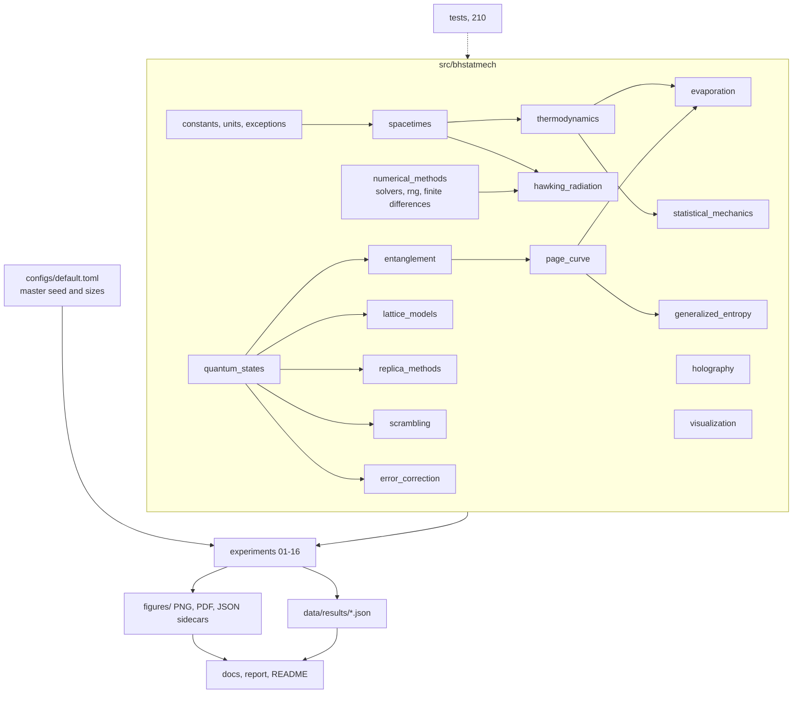

## Installation

Requires Python 3.11 or newer.

```bash
git clone <your-repository-url>
cd black-hole-statistical-mechanics
python -m venv .venv && source .venv/bin/activate
pip install -e ".[dev]"
```

## Quick start

```python
from bhstatmech.spacetimes import Schwarzschild
from bhstatmech.constants import M_SUN

bh = Schwarzschild(M_SUN)
print(bh.schwarzschild_radius)         # about 2953 m
print(bh.hawking_temperature)          # about 6.2e-8 K
```

or run the complete example (Schwarzschild solar-mass numbers, a Bell pair, and an exact 10-qubit Page curve):

```bash
python scripts/quickstart.py
```

## Running experiments and tests

```bash
python -m pytest                         # 210 tests, about 30 s
python scripts/run_experiment.py 09      # one experiment by number
python scripts/run_all_experiments.py --clean   # all 16 experiments, regenerates figures/ and data/results/
python scripts/validate_results.py       # checks files, finiteness and key numbers
python scripts/package_zip.py            # builds and verifies the archive
```

`make test`, `make experiments`, `make validate` and `make zip` are equivalent shortcuts. Experiment 05 (greybody factors) takes about 2.5 minutes; the others take seconds to a minute or so.

## Figure gallery

Every figure is produced by the experiment script named under its title, saved as PNG and PDF, with a JSON sidecar recording caption, parameters, seed and package version (`figures/manifest.json` indexes them). The captions below are the recorded captions.

### Geometry and thermodynamics

**Figure 1. Metric function** (`experiments/01_black_hole_geometry.py`)

<p align="center">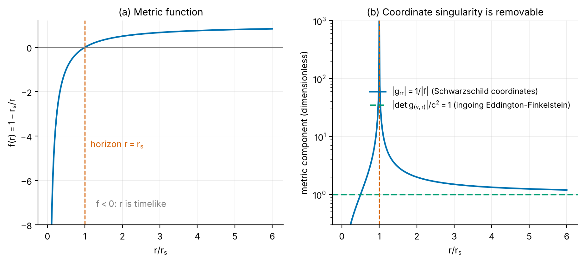</p>

> Schwarzschild metric function f(r) (left). The component g\_rr = 1/f diverges at the horizon in Schwarzschild coordinates but the determinant of the (v, r) block of the ingoing Eddington-Finkelstein metric equals -c^2 everywhere, so the horizon is a coordinate artefact there (right).

**Figure 2. Kretschmann scalar** (`experiments/01_black_hole_geometry.py`)

<p align="center">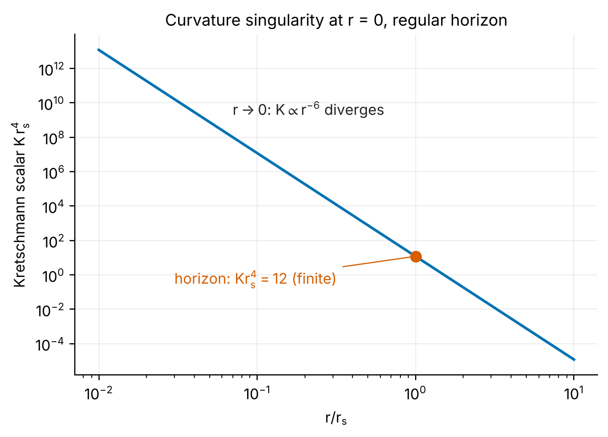</p>

> K = 12 r\_s^2 / r^6 = 48 G^2 M^2 / (c^4 r^6), verified symbolically (tests/test\_spacetimes.py). K is finite at r = r\_s, so the horizon is not a curvature singularity; K diverges only at r = 0.

**Figure 3. Tortoise coordinate** (`experiments/01_black_hole_geometry.py`)

<p align="center">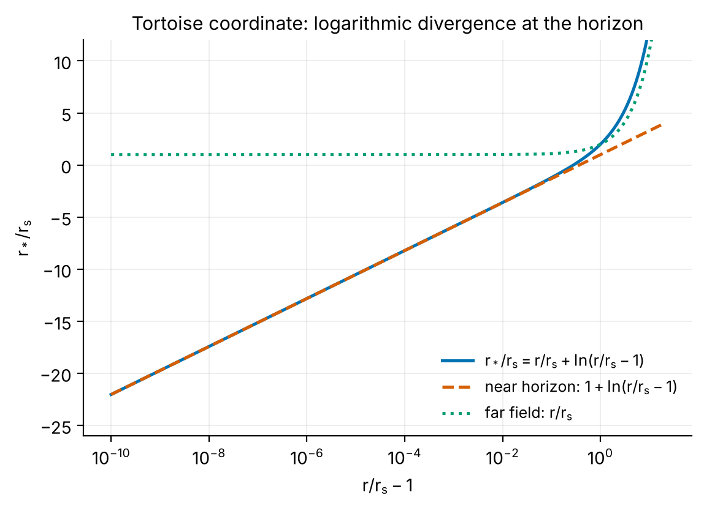</p>

> r\_\* = r + r\_s ln(r/r\_s - 1). Fitted slope d(r\_\*/r\_s)/d ln(r/r\_s - 1) for r/r\_s - 1 &lt; 1e-4 is 1.000003 (expected 1). The horizon is infinitely far away in r\_\*, which underlies the mode definitions used for Hawking radiation.

**Figure 4. Radial null rays** (`experiments/01_black_hole_geometry.py`)

<p align="center">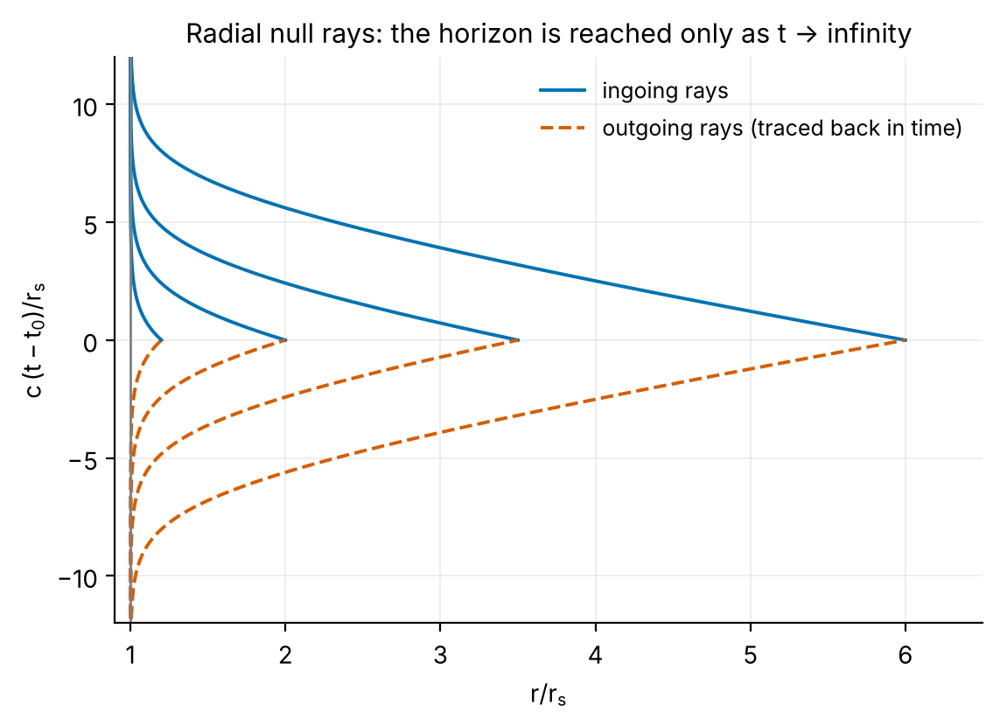</p>

> Radial null geodesics t = t0 +/- (r\_\*(r) - r\_\*(r0))/c in Schwarzschild time. Rays approach r = r\_s only asymptotically in t, illustrating the coordinate singularity of Schwarzschild time at the horizon.

**Figure 5. Hawking temperature** (`experiments/02_thermodynamic_laws.py`)

<p align="center">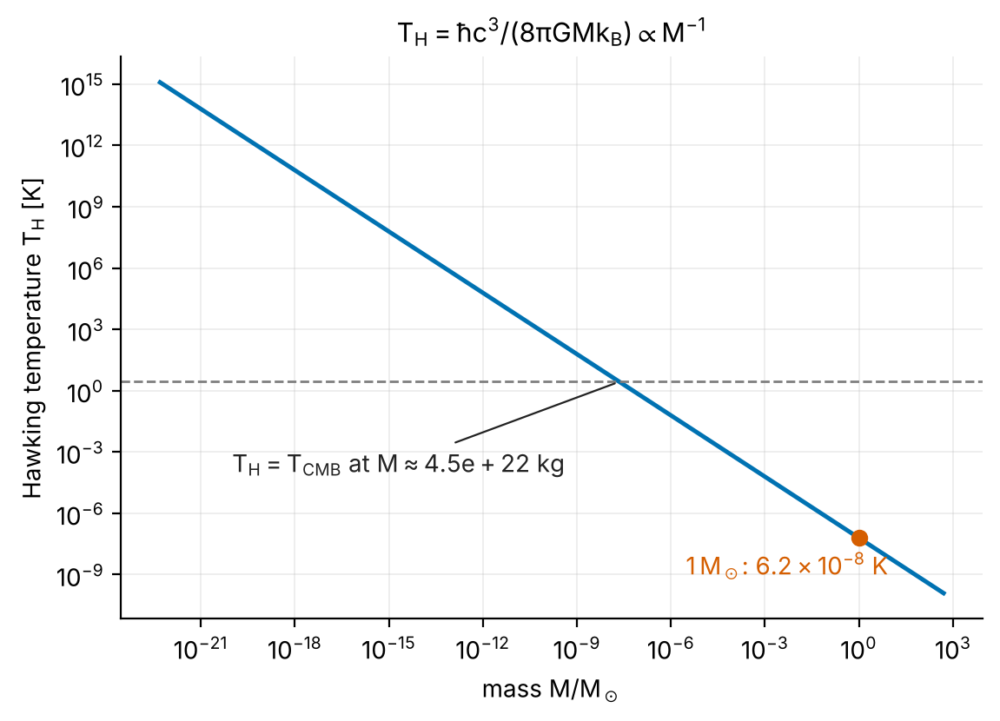</p>

> Hawking temperature versus mass for Schwarzschild black holes. A black hole is hotter than the 2.725 K CMB only below about 4.5e+22 kg; stellar-mass holes (T ~ 1e-7 K) absorb more than they radiate in the present universe.

**Figure 6. Entropy vs mass** (`experiments/02_thermodynamic_laws.py`)

<p align="center">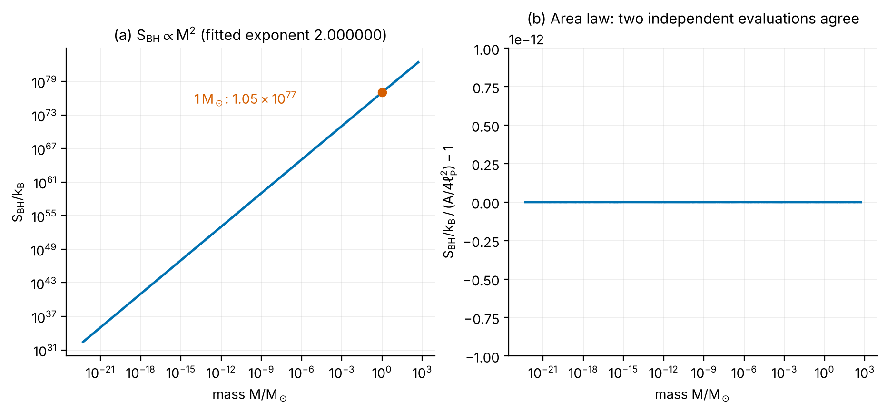</p>

> Bekenstein-Hawking entropy S\_BH = 4 pi k\_B G M^2/(hbar c). Fitted log-log slope 2.00000000; the ratio of the closed form to A/(4 l\_P^2) deviates from 1 by at most 4.4e-16 (floating-point round-off).

**Figure 7. First law residual** (`experiments/02_thermodynamic_laws.py`)

<p align="center">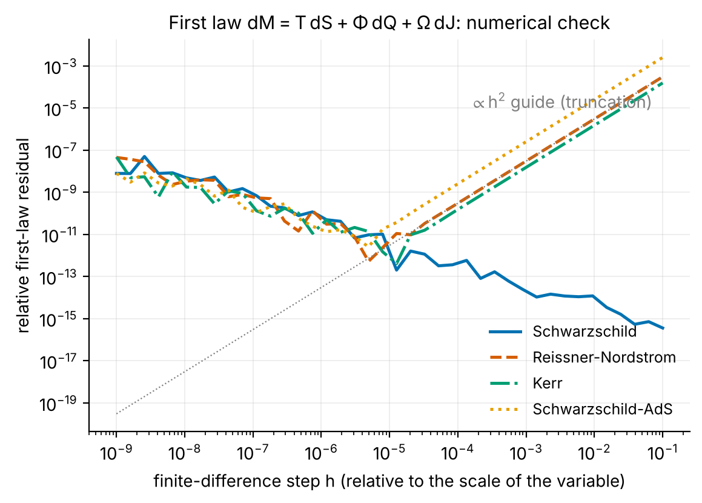</p>

> Relative residual of the first law of black-hole mechanics evaluated with central finite differences of the analytic M(S, Q, J). The residual follows the O(h^2) truncation error at large steps and is limited by round-off at small steps (the Schwarzschild entropy is exactly quadratic in M, so it is dominated by round-off throughout).

**Figure 8. Heat capacity stability** (`experiments/02_thermodynamic_laws.py`)

<p align="center">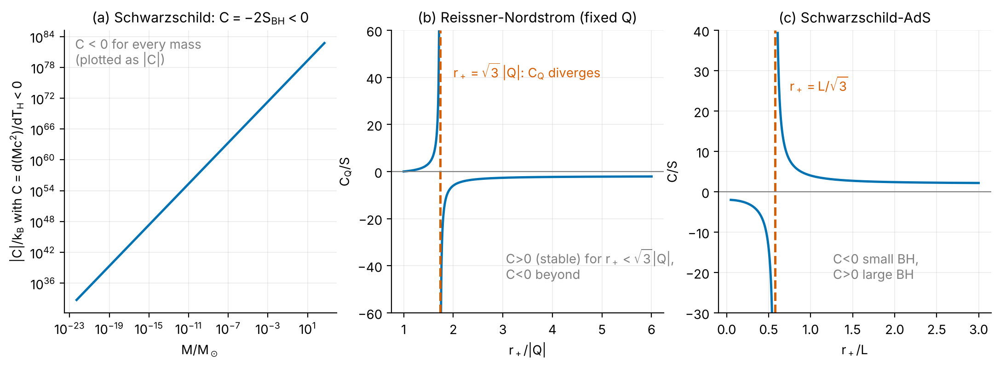</p>

> Heat capacities in their stated ensembles. Schwarzschild: C = -2 S\_BH &lt; 0 (local thermodynamic instability). RN at fixed charge: positive for r\_+ &lt; sqrt(3)|Q| (near-extremal), diverging and negative beyond. Schwarzschild-AdS at fixed L: negative for r\_+ &lt; L/sqrt(3) (small BH), positive for large BH. Local thermodynamic stability is distinct from global preference (Fig 09) and from dynamical stability, which is not analysed here.

**Figure 9. Free energy hawking page** (`experiments/02_thermodynamic_laws.py`)

<p align="center">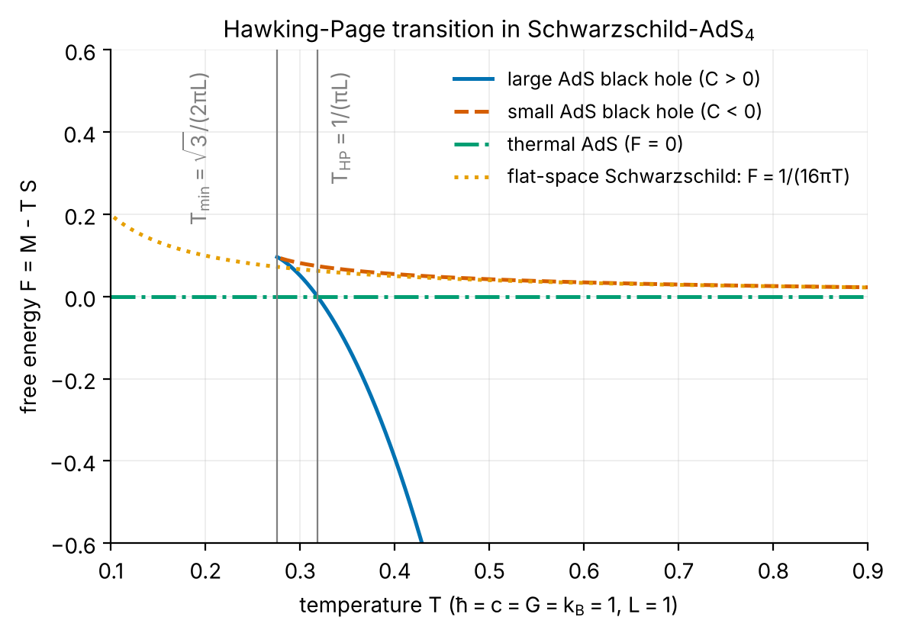</p>

> Free energy of Schwarzschild-AdS black holes (large branch solid, small branch dashed) compared with thermal AdS (F = 0). Black holes exist only above T\_min = sqrt(3)/(2 pi L); the large branch crosses F = 0 at T\_HP = 1/(pi L) (r\_+ = L), reproducing the Hawking-Page transition (Hawking and Page 1983). Asymptotically flat Schwarzschild has F = M/2 &gt; 0 at all temperatures and no preferred equilibrium (negative heat capacity).

**Figure 10. Extremal limits** (`experiments/02_thermodynamic_laws.py`)

<p align="center">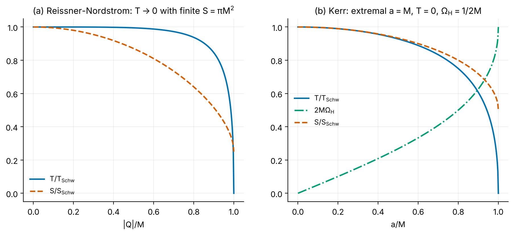</p>

> Temperature, entropy and horizon angular velocity as functions of charge-to-mass ratio (RN) and spin (Kerr), normalised to the Schwarzschild values at equal M. T vanishes continuously at extremality with finite entropy; the Kerr Smarr relation M = 2TS + 2 Omega J holds to round-off (tests/test\_spacetimes.py). The horizon radius is computed as sqrt((M-Q)(M+Q)) to avoid cancellation near extremality.

**Figure 11. Evaporation** (`experiments/02_thermodynamic_laws.py`)

<p align="center">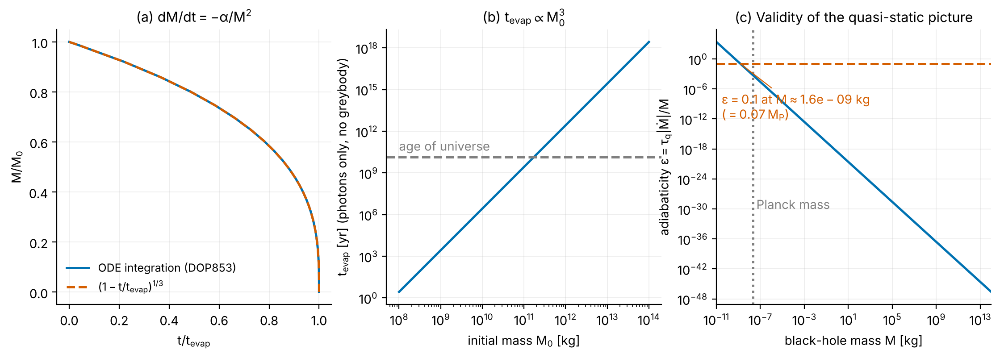</p>

> Quasi-static photon-only evaporation (L = sigma\_SB A T\_H^4, no greybody factors or other species): numerical integration vs the closed form, lifetime scaling and the adiabaticity parameter epsilon = (hbar/k\_B T\_H)|dM/dt|/M. The photon-only lifetime equals the age of the universe at M ~ 1.73e+11 kg. These lifetimes are approximations. epsilon grows as M^-2 but is still only 5.2e-04 at the Planck mass (it reaches 0.1 at 0.07 M\_P), so this heuristic criterion does not locate the breakdown of the semiclassical picture; Planck-scale effects are expected earlier and are not modelled. The model is not extended to the endpoint.

**Figure 12. Entropy vs area log correction** (`experiments/03_entropy_scaling.py`)

<p align="center">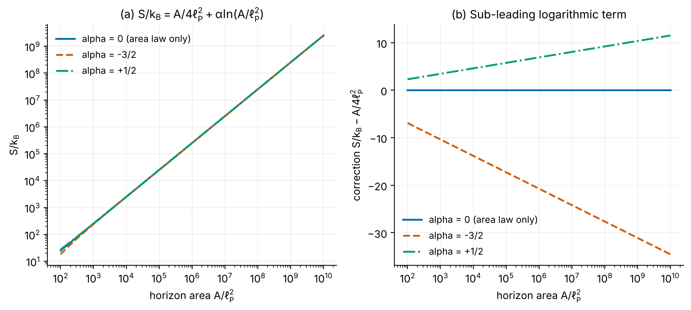</p>

> Bekenstein-Hawking entropy with a parameterised logarithmic correction. The coefficient alpha is model dependent and the three values shown are illustrative only (different microscopic approaches give different values; none is assumed here). The fitted slope of the correction against ln A recovers alpha = -1.500000 for the alpha = -3/2 curve.

**Figure 13. Area vs volume scaling** (`experiments/03_entropy_scaling.py`)

<p align="center">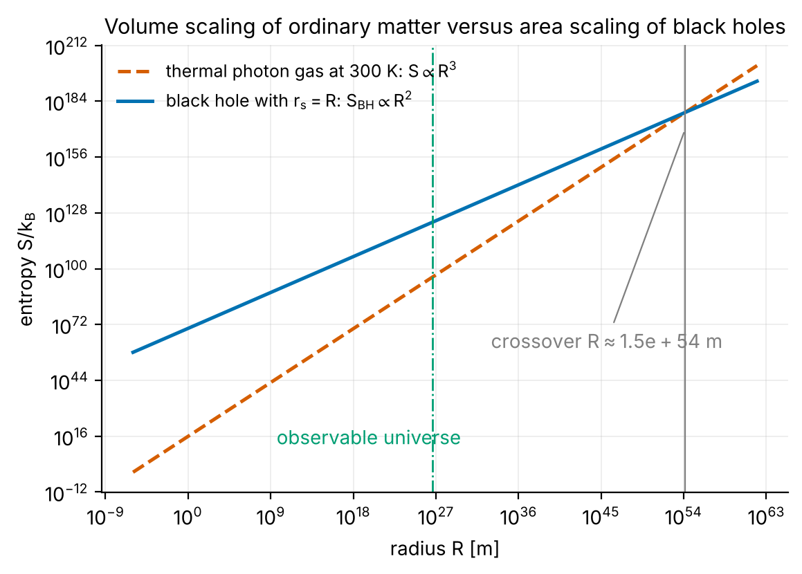</p>

> An ordinary thermal system (photon gas at fixed temperature) has extensive entropy S ~ R^3, whereas the Bekenstein-Hawking entropy of a black hole of radius R scales as R^2. At 300 K the crossover lies at R ~ 1.5e54 m, far beyond the observable universe (4.4e26 m), so the plot illustrates only the different scaling exponents, not a bound; it does not identify the black-hole microstates.

**Figure 14. Ensembles finite vs gravitating** (`experiments/03_entropy_scaling.py`)

<p align="center">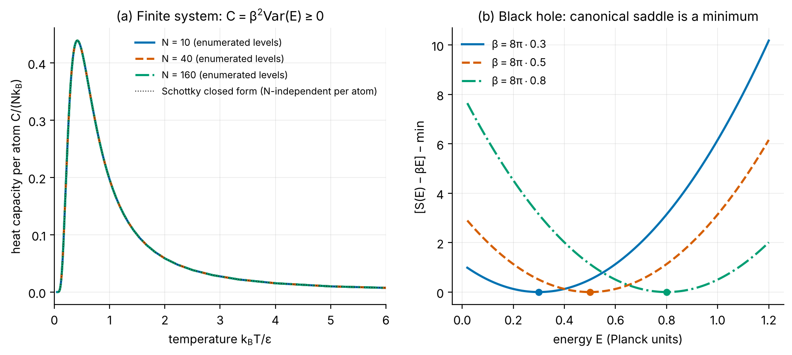</p>

> (a) Heat capacity of finite two-level systems computed directly from the density of states (binomial degeneracies) and compared with the closed form; it is non-negative in the canonical ensemble. (b) For S(E) = 4 pi E^2 the exponent S(E) - beta E of the canonical integral has its stationary point at E = beta/(8 pi), which is a minimum (second derivative 8 pi &gt; 0): the canonical integral does not converge as a dominated saddle and the canonical and microcanonical descriptions disagree (Planck units, k\_B = 1).


### Hawking radiation and greybody factors

**Figure 15. Hawking spectra** (`experiments/04_hawking_spectra.py`)

<p align="center">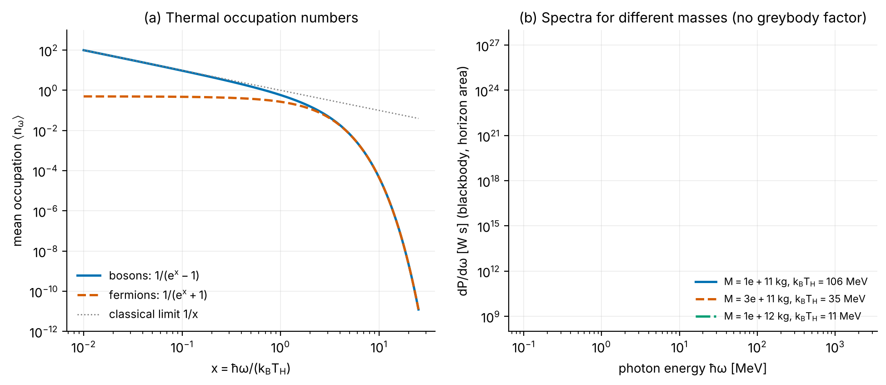</p>

> (a) Bose-Einstein and Fermi-Dirac occupation as functions of x = hbar omega/(k\_B T\_H). (b) Photon-only blackbody spectra with the horizon area for three masses; the peak sits near x = 2.82 (Wien, in terms of dP/domega) and moves to lower energy as M grows. A thermal curve illustrates the spectrum; it is not a derivation of Hawking radiation (see docs/hawking\_radiation.md), and greybody factors (Figs 18-20) modify it.

**Figure 16. Effective potentials** (`experiments/05_greybody_factors.py`)

<p align="center">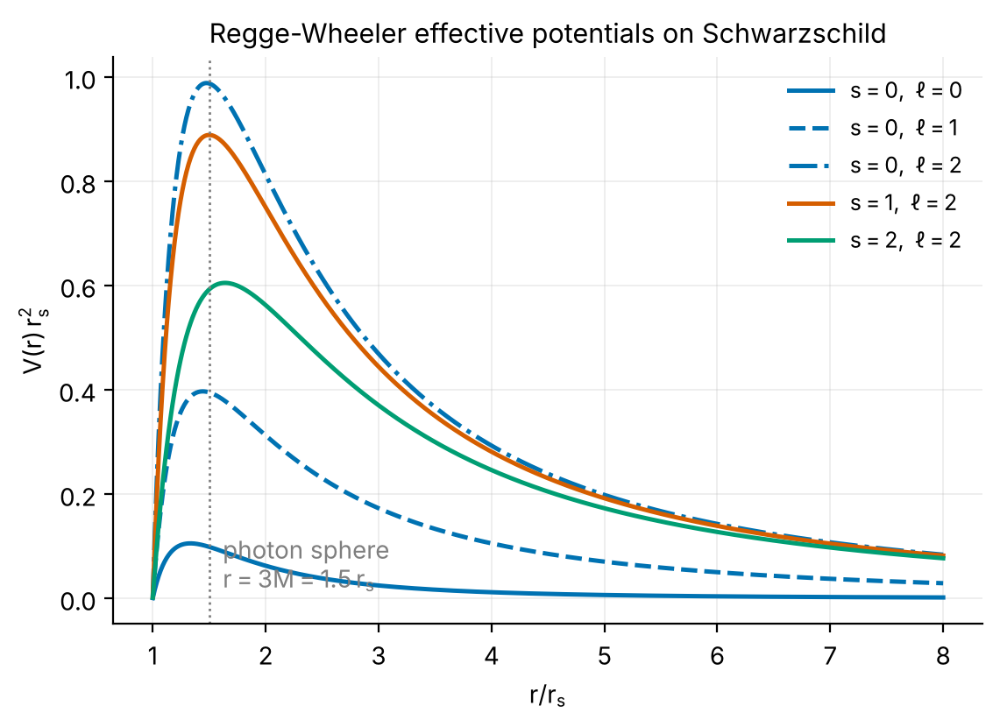</p>

> Effective potentials V = f \[l(l+1)/r^2 + (1 - s^2) r\_s/r^3\] for massless fields of spin s = 0, 1, 2 (units r\_s = 1). The barrier peak lies near the photon sphere and rises like l(l+1); the scattering of waves off it determines the greybody factor. All potentials vanish at the horizon and decay as l(l+1)/r^2 at infinity.

**Figure 17. Greybody factors** (`experiments/05_greybody_factors.py`)

<p align="center">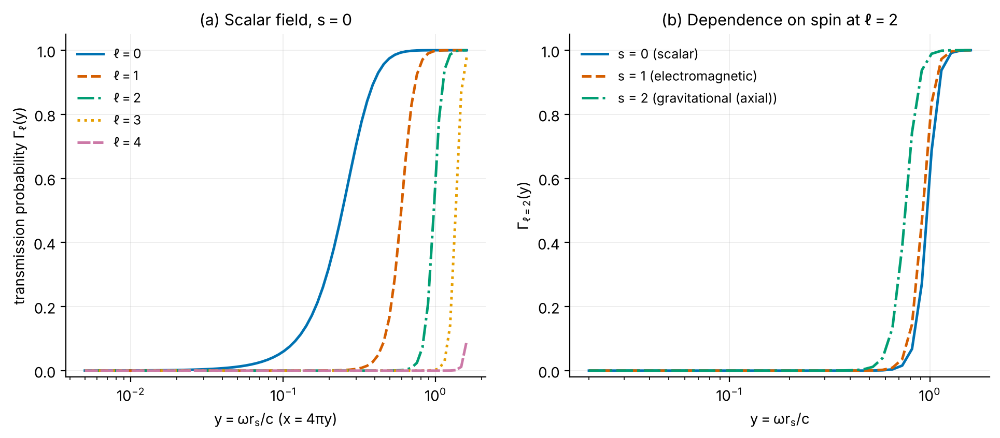</p>

> Transmission probabilities obtained by integrating the radial wave equation from the horizon (pure ingoing wave) to a large radius and decomposing into Riccati-Hankel waves. All values lie in \[0, 1\] and Wronskian flux conservation holds to 1e-09 (relative to the incident flux). Low multipoles transmit well above y ~ 0.3 while high multipoles are suppressed by the centrifugal barrier. Spin-1 and spin-2 fields have a stronger barrier at the same l.

**Figure 18. Absorption cross section** (`experiments/05_greybody_factors.py`)

<p align="center">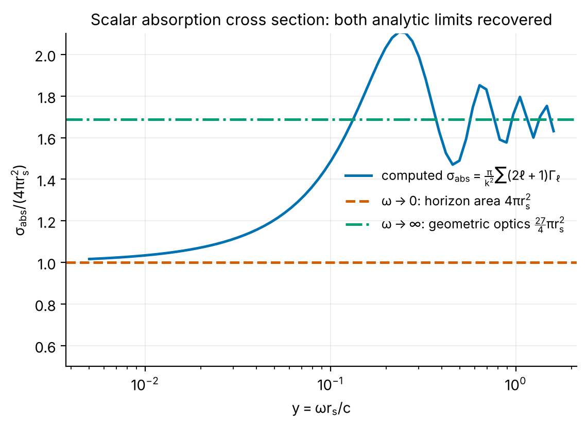</p>

> Absorption cross-section of the Schwarzschild black hole for a massless scalar from the computed transmission probabilities. It tends to the horizon area as omega -&gt; 0 (Das, Gibbons and Mathur 1997) and oscillates around the geometric-optics value (27/4) pi r\_s^2 at high frequency (Sanchez 1978). Adding one further multipole changes sigma by at most 9.2e-11 (relative) over the range.

**Figure 19. Emission rate greybody** (`experiments/05_greybody_factors.py`)

<p align="center">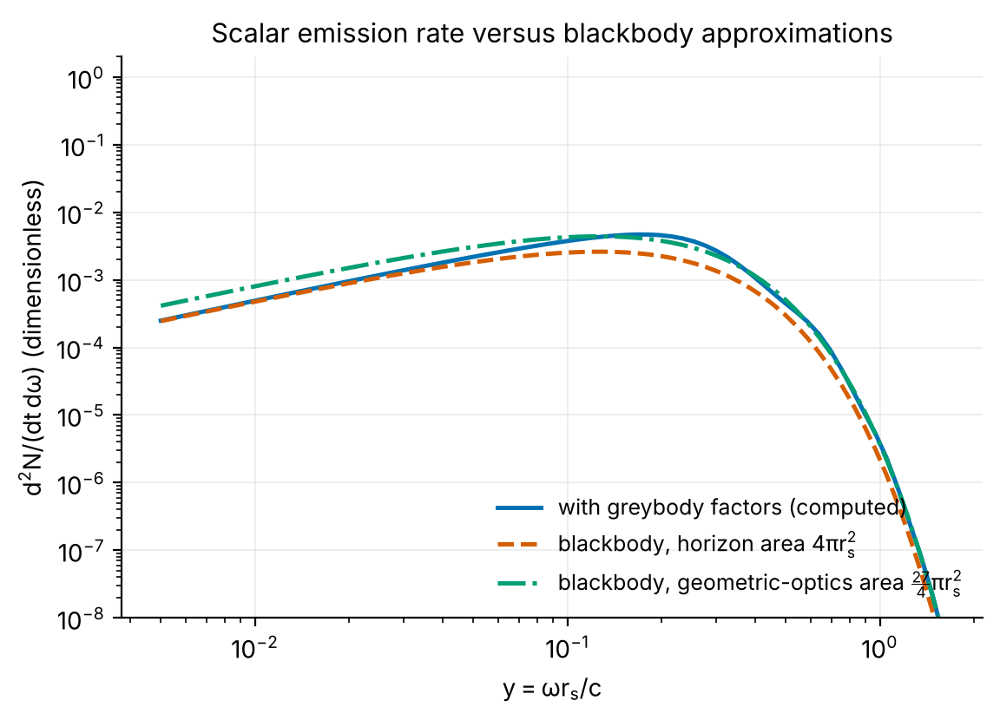</p>

> d^2N/(dt d omega) = (1/2 pi) sum (2l+1) Gamma\_l / (exp(hbar omega/k\_B T\_H) - 1) for a single real scalar, computed from the transmission probabilities, compared with blackbody emission from the horizon area and from the geometric-optics capture area. At low frequency the s-wave reproduces the horizon-area blackbody; the integrated scalar power is 7.19 times the horizon-area blackbody power for one bosonic degree of freedom (the geometric-optics blackbody, with emitting area 4 pi b\_c^2 = 27 pi r\_s^2, gives 27/4 = 6.75 and is reproduced numerically).


### Quantum states and horizon entanglement models

**Figure 20. Bell and product entropies** (`experiments/06_quantum_states.py`)

<p align="center">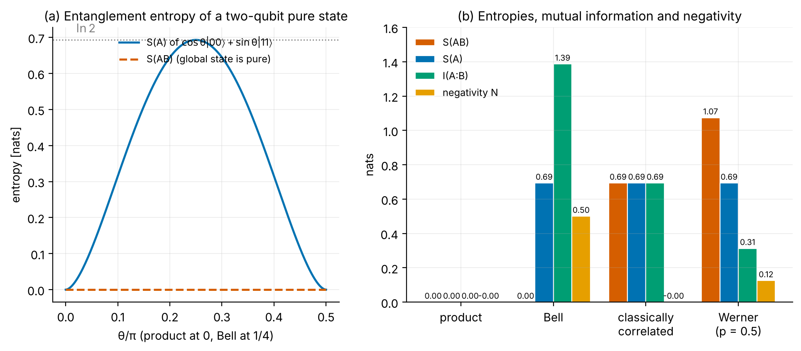</p>

> (a) Single-qubit entropy of cos(t)|00&gt; + sin(t)|11&gt;: zero for the product state, ln 2 for the Bell state, while the global entropy is zero throughout. (b) Product state: all quantities vanish. Bell state: S(AB) = 0, S(A) = ln 2, I = 2 ln 2, N = 1/2. Classically correlated mixture: I = ln 2 but N = 0 (correlation without entanglement). Werner state p = 0.5: mixed, entangled.

**Figure 21. Density matrix eigenvalues** (`experiments/06_quantum_states.py`)

<p align="center">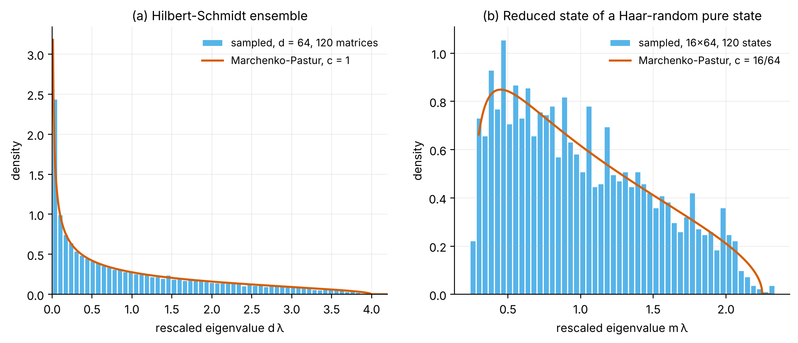</p>

> Eigenvalue distributions of random density matrices. (a) Hilbert-Schmidt measure (G G^dagger normalised, square Ginibre G) for d = 64 follows the Marchenko-Pastur law with c = 1 (support \[0, 4\]). (b) The reduced state of a Haar-random 16 x 64 bipartite pure state follows Marchenko-Pastur with c = m/n = 1/4 (support \[1/4, 9/4\]); the gap at zero is the signature of a subsystem much smaller than its complement (Page regime).

**Figure 22. Density matrix gallery** (`experiments/06_quantum_states.py`)

<p align="center">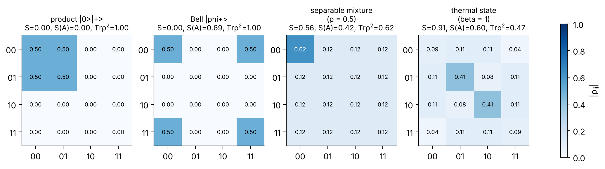</p>

> Magnitudes |rho\_ij| of two-qubit density matrices in the computational basis, with global entropy S, single-qubit entropy S(A) and purity Tr(rho^2) in the panel titles. The Bell state has off-diagonal coherences between |00&gt; and |11&gt;; the separable mixture has coherences too but is not entangled (negativity 0).

**Figure 23. Mutual information purity** (`experiments/06_quantum_states.py`)

<p align="center">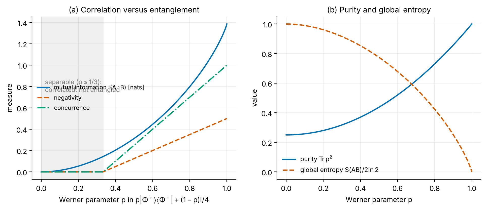</p>

> Werner states. Mutual information is non-zero for every p &gt; 0 (it counts classical and quantum correlations) whereas negativity and concurrence vanish for p &lt;= 1/3 (computed threshold on the grid: p = 0.335). Purity decreases monotonically as p decreases; the global entropy is 0 only at p = 1.

**Figure 24. Thermofield pair entropy** (`experiments/07_horizon_entanglement.py`)

<p align="center">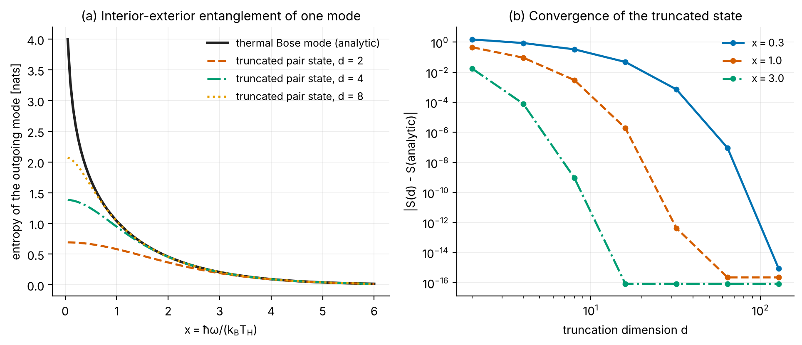</p>

> Truncated two-mode squeezed (Bogoliubov-pair) state |Psi&gt; = sqrt(1-q) sum\_n q^{n/2}|n&gt;\_in|n&gt;\_out with q = exp(-hbar omega/k\_B T\_H). The global state is pure; tracing out the interior gives the thermal Bose distribution with &lt;n&gt; = 1/(e^x - 1) and entropy (n+1)ln(n+1) - n ln n. d = 2 reproduces the large-x limit (a qubit) only. Convergence in d is geometric, faster at large x. This models the mode structure, not the near-horizon field dynamics that produce it.

**Figure 25. Pair emission model** (`experiments/07_horizon_entanglement.py`)

<p align="center">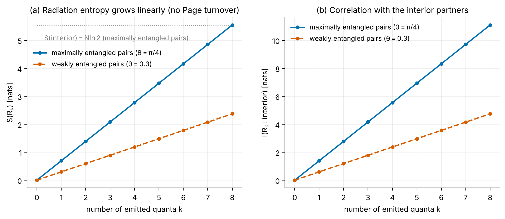</p>

> N = 8 independent horizon pairs. Radiation R\_k is the first k outgoing qubits; the interior holds all N partners. S(R\_k) = k S\_pair and I(R\_k:interior) = 2 S(R\_k): the emission entropy grows monotonically because the model never lets the radiation interact with the interior, i.e. it encodes the semiclassical (Hawking) assumption and has no mechanism to return information. Compare Figs 28-31, where unitary dynamics among the remaining degrees of freedom produces a turnover.

**Figure 26. Lattice entanglement** (`experiments/08_lattice_entanglement.py`)

<p align="center">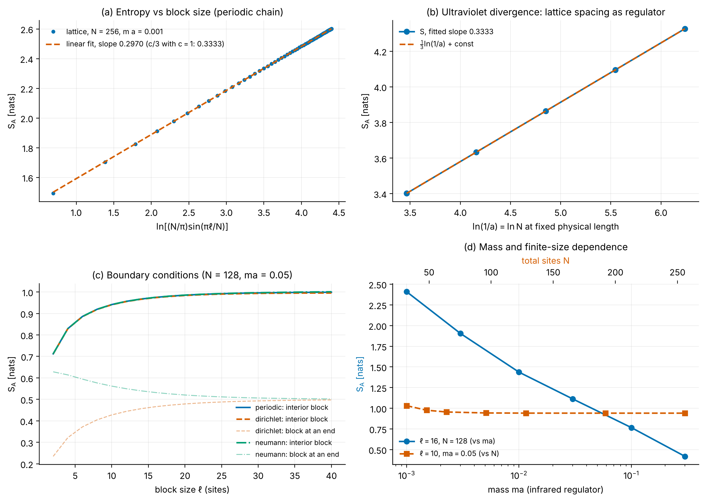</p>

> Ground-state entanglement entropy of a block of the massless-limit harmonic chain (Gaussian state, symplectic spectrum of the block covariance). (a) The slope against ln\[(N/pi) sin(pi l/N)\] is 0.2970, about 11% below the CFT value c/3 = 1/3 (c = 1). The deficit is an infrared effect: the correlation length 1/(ma) = 1000 sites is only 3.9 times the chain length, and diagnostics outside this script show the fitted slope falls further for larger ma (about 0.14 at ma = 0.01, N = 256) and approaches 1/3 as m N -&gt; 0. (b) At fixed physical size the entropy grows as 0.3333 ln(1/a): the lattice spacing regulates the ultraviolet divergence. (c) Dirichlet/Neumann ends change the entropy of an end block (one entangling point instead of two) but not the interior block far from the boundary. (d) The IR mass lowers the entropy; finite-size corrections shrink as N grows. This is a lattice-field result, not a black-hole entropy calculation.


### Page curve, evaporation and replicas

**Figure 27. Page curves dimensions** (`experiments/09_page_curve.py`)

<p align="center">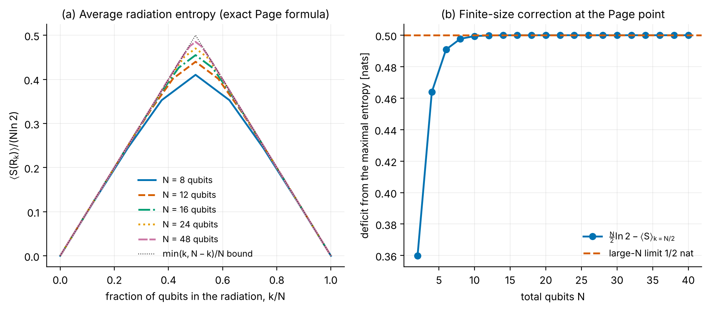</p>

> Haar-average entropy of the first k of N qubits from Page's exact formula &lt;S\_{m,n}&gt; = psi(mn+1) - psi(n+1) - (m-1)/(2n). The normalised curves approach the piecewise-linear bound min(k, N-k)/N as N grows (the rise-then-fall shape comes from sampling pure states of a fixed total dimension, not from an imposed curve). At the symmetric point the average falls short of the maximal value (N/2) ln 2 by 1/2 nat in the large-N limit (b).

**Figure 28. Page curve ensembles** (`experiments/09_page_curve.py`)

<p align="center">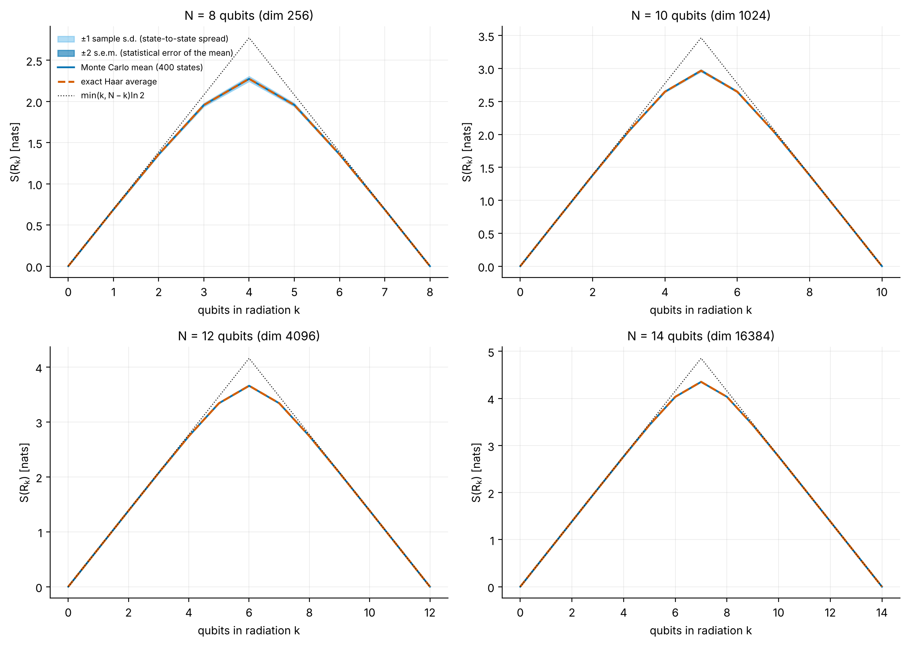</p>

> Ensemble of Haar-random pure states of N qubits; S(R\_k) is the entropy of the first k qubits. Dark band: +/- 2 standard errors of the mean (this is the Monte Carlo error); light band: +/- 1 sample standard deviation (the genuine state-to-state fluctuation, which shrinks as N grows). The Monte Carlo mean agrees with the exact average within the statistical error. Results are reproducible for the seeds recorded in the figure sidecar.

**Figure 29. Hawking vs page reference** (`experiments/09_page_curve.py`)

<p align="center">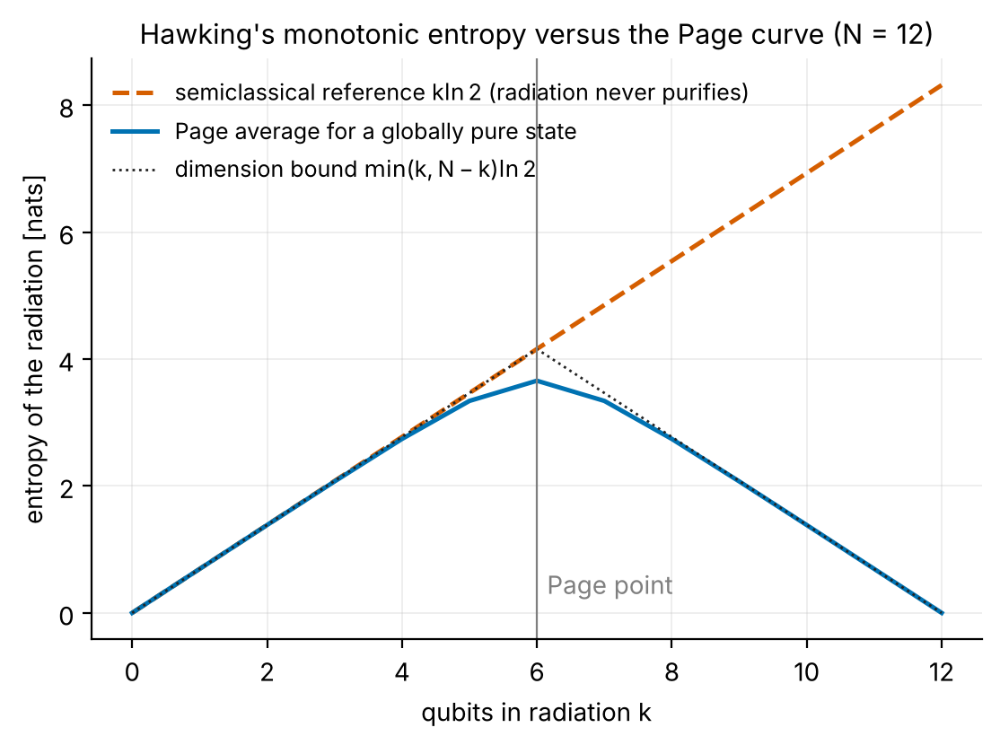</p>

> The monotonic semiclassical reference S = k ln 2 (each emitted quantum is maximally entangled with a partner that stays out of reach) violates the dimension bound for k &gt; N/2. The entropy of the radiation in any globally pure state of the finite system must turn over at or before the Page point, because S(R) = S(B) &lt;= (N-k) ln 2.

**Figure 30. Renyi entropy vs index** (`experiments/11_replica_entropy.py`)

<p align="center">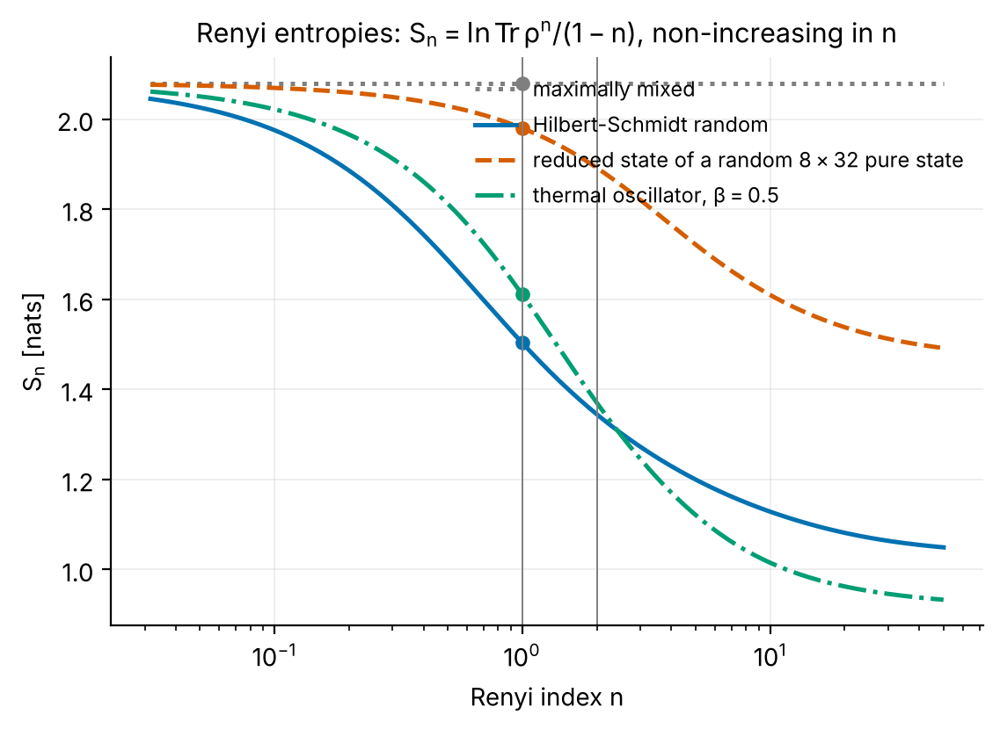</p>

> Renyi entropies of four d = 8 states computed from the eigenvalues. S\_0 = ln rank, S\_1 is the von Neumann entropy (markers), S\_2 = -ln Tr rho^2 and S\_infinity = -ln lambda\_max. The curves are non-increasing in n and flat only for the maximally mixed state, whose spectrum is flat.

**Figure 31. Replica vs direct entropy** (`experiments/11_replica_entropy.py`)

<p align="center">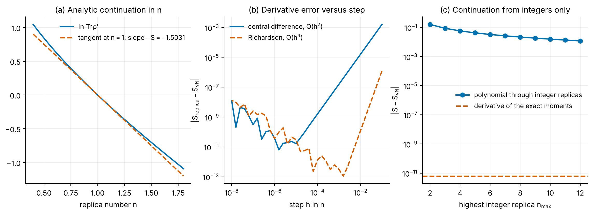</p>

> Replica identity for a random d = 8 density matrix (S\_vN = 1.503146). (a) ln Tr rho^n and its tangent at n = 1. (b) Finite-difference error: quadratic in h for the central difference and quartic for Richardson down to a round-off floor of ~1e-10..1e-11. (c) In finite dimension the continuation from integer replicas alone (polynomial interpolation) converges only slowly; gravitational path integrals provide only integer-n data, which is why the analytic continuation is the hard step there. A finite-dimensional calculation is not a gravitational path integral.

**Figure 32. Unitary vs nonunitary evaporation** (`experiments/10_random_unitary_evaporation.py`)

<p align="center">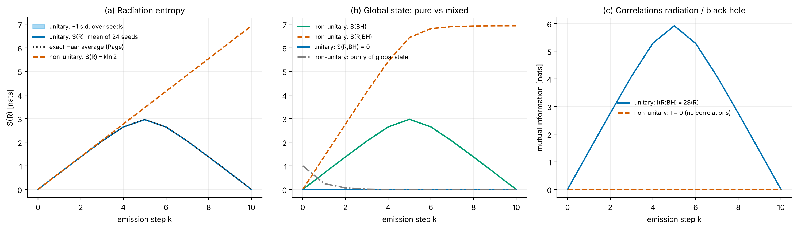</p>

> Toy evaporation of an N = 10 qubit register: each step applies a Haar-random unitary to the remaining black-hole qubits and then emits one qubit. (a) Unitary evolution reproduces the Page curve (mean over 24 seeds vs the exact average); the non-unitary reference (each emitted qubit is traced out of a mixed register and discarded from correlations) gives the monotonic Hawking-like S(R) = k ln 2. (b) The unitary global state stays pure (max norm deviation 8.9e-16); the non-unitary one becomes mixed. (c) The mutual information between radiation and black hole is 2 S(R) in the unitary model and zero in the reference. Non-unitary averages use 4 seeds. This is a qubit toy model, not a gravitational calculation.

**Figure 33. Entanglement spectrum evolution** (`experiments/10_random_unitary_evaporation.py`)

<p align="center">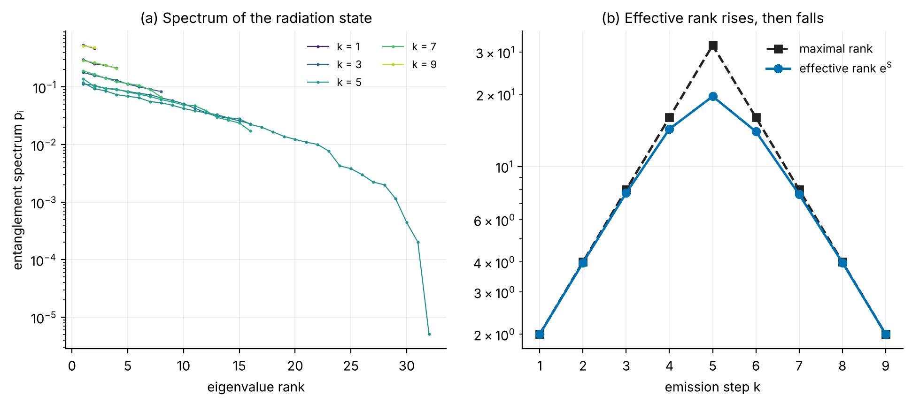</p>

> Entanglement spectrum of the radiation for one seed of the unitary toy. The number of nonzero eigenvalues is bounded by min(2^k, 2^(N-k)); the effective rank exp(S) follows it up to the Page point and then decreases, which is the spectral statement of the Page turnover.


### Islands, holography, scrambling and error correction

**Figure 34. Generalized entropy branches** (`experiments/12_generalized_entropy.py`)

<p align="center">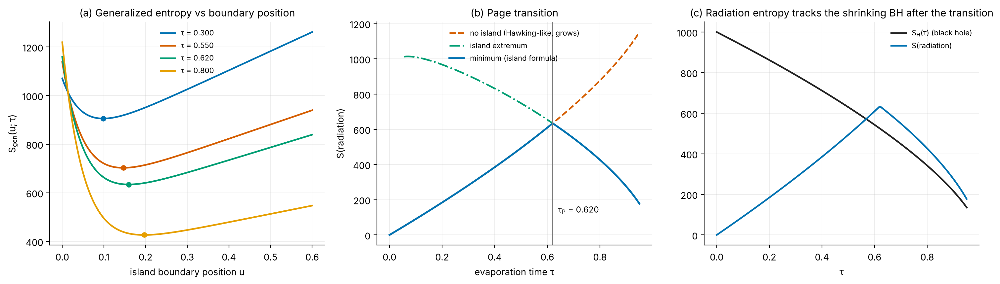</p>

> Phenomenological island toy model S\_gen(u) = S\_H(1 + mu u) + S\_rad exp(-u/xi) with S\_H = S0 (1-tau)^(2/3) and S\_rad = r (S0 - S\_H); parameters S0 = 1000, r = 1.333, mu = 1, xi = 0.05. (a) The island candidate is a minimum of S\_gen in u (dots). (b) The entropy of the radiation is the smaller of the no-island and island branches; the switch at tau\_P = 0.6203 is a kink, i.e. a first-order-like transition. (c) After tau\_P the radiation entropy follows the black-hole entropy. The functional form and parameters are illustrative assumptions, not derived from gravity.

**Figure 35. Island parameter study** (`experiments/13_island_model.py`)

<p align="center">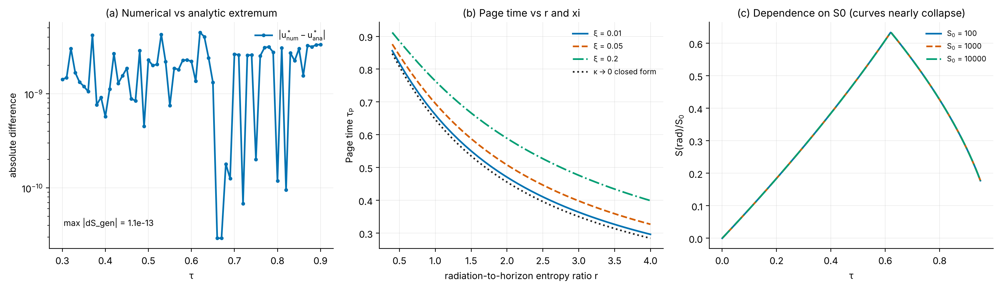</p>

> (a) Bounded-minimiser and closed-form island locations agree to ~1e-8 (max difference in S\_gen 1.1e-13). (b) Page time of the toy model against the entropy ratio r for several xi; xi (through kappa = mu xi) shifts it only slightly from the kappa -&gt; 0 closed form 1 - (r/(1+r))^(3/2). (c) The normalised curve depends weakly on S0, so the shape is set by r and xi. All parameters are illustrative.

**Figure 36. Holographic entropy ads3 btz** (`experiments/14_holographic_entropy.py`)

<p align="center">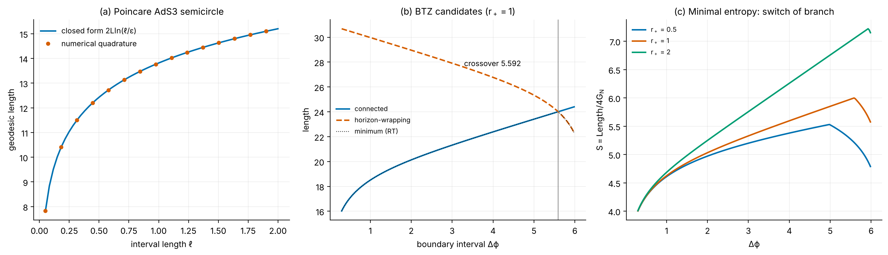</p>

> Ryu-Takayanagi lengths with L = 1, G\_N = 1. (a) The closed-form Poincare AdS3 geodesic length and a numerical quadrature of the semicircle agree. (b) In BTZ the connected geodesic competes with the horizon-wrapping candidate; they cross at Delta phi = 5.5919 (the cutoff cancels). The minimum encodes the Araki-Lieb behaviour S(A) - S(A^c) = (horizon length)/4G. (c) Entropy S = min(length)/4G\_N; the kink marks the switch to the horizon-wrapping candidate and moves toward 2 pi as r\_+ increases (about 5.59 at r\_+ = 1), so for large r\_+ the entropy is the connected-geodesic (extensive thermal) result over almost the whole circle. An independent turning-radius integration reproduces the connected closed form to 1.2e-07. Central charge c = 3L/2G\_N; only the 2D vacuum and BTZ geometries are treated.

**Figure 37. Scrambling otoc entanglement** (`experiments/15_scrambling.py`)

<p align="center">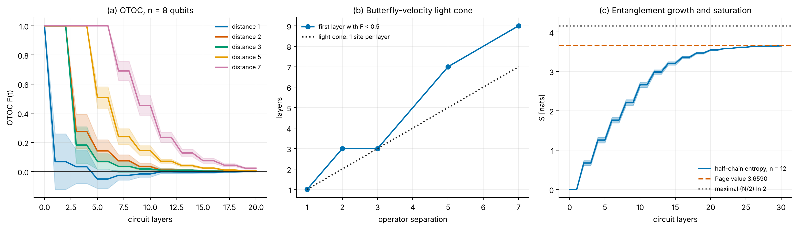</p>

> Haar-random two-qubit brickwork circuits. (a) The OTOC F = Re Tr\[W(t)^dag V^dag W(t) V\]/d between Z on site 0 and Z at the stated distance stays at 1 until the operator front arrives and then decays toward ~0 (mean over 24 circuits, bands +/- 2 s.e.m.). (b) The arrival layer grows linearly with distance, a discrete light cone (open boundary conditions, so edge effects exist). (c) Half-chain entanglement from a product state saturates at 3.650 +/- 0.002 versus the Page value 3.659. Exact state-vector calculations; small sizes only.

**Figure 38. Quantum error correction** (`experiments/16_quantum_error_correction.py`)

<p align="center">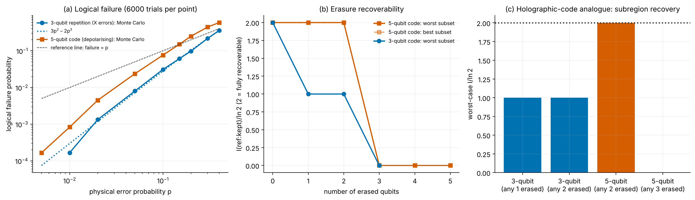</p>

> (a) Monte Carlo logical failure of the 3-qubit repetition code under independent bit flips (agrees with 3p^2 - 2p^3) and the 5-qubit perfect code under independent depolarising noise (failure ~ O(p^2)); points with zero observed failures are omitted; counts are over 6000 trials, binomial error ~ sqrt(f(1-f)/6000). (b) Coherent-information-style diagnostic I(ref:kept) for a maximally entangled reference: the 5-qubit code keeps the logical qubit recoverable (2 ln 2) after erasing any 2 qubits and loses it at 3, matching its distance 3; the repetition code protects only against X errors and is not an erasure-correcting code for quantum information. (c) Worst-case recoverability. This is a finite-code toy analogue of subregion reconstruction in holography, not a derivation of it.


## Validated results

The following were produced by this code in the recorded build (details and more checks in [docs/validation.md](docs/validation.md); raw numbers in `data/results/`).

| Check | Result |
| --- | --- |
| Test suite | 210 passed |
| First law (Schwarzschild), finite-difference residual | about $10^{-12}$, scales as $h^2$ |
| Entropy vs mass log-log slope | 2.0 |
| Hawking-Page (AdS, $L=1$) | $T_{min}=0.27566$, $T_{HP}=0.31831$ |
| Solar-mass black hole | $T_H=6.17\times10^{-8}$ K, $S/k_B=1.05\times10^{77}$ |
| Greybody flux conservation | relative defect $\le1.1\times10^{-9}$ |
| Greybody high-frequency cross-section | oscillates about $27\pi r_s^2/4$ (ratio 0.934 to 1.097) |
| Page deficit at the symmetric point, $N=40$ | 0.5000 nat |
| Unitary toy (10 qubits) peak entropy vs exact Page | 2.960 vs 2.966 nats; global state pure to $9\times10^{-16}$ |
| Island toy model Page time | $\tau_P=0.6203$ (illustrative parameters) |
| BTZ crossover angle ($r_+=L=1$) | 5.5919 |
| Lattice UV slope ($S$ vs $\ln N$) | 0.33334 vs $1/3$ |
| Lattice CFT-window slope ($N=256$, $ma=10^{-3}$) | 0.297 (11% below $1/3$, infrared effect) |
| 12-qubit circuit entanglement | $3.6496\pm0.0016$ vs Page 3.6590 (about 0.009 below) |
| 5-qubit code | any 2 erasures recoverable, any 3 not |

## Reproducibility

- A single `master_seed` (20261022) in `configs/default.toml` seeds every random stream through `numpy.random.SeedSequence`.
- Each figure sidecar records the generating script, parameters, seed and package version.
- `scripts/run_all_experiments.py --clean` regenerates all figures and result files from scratch; `scripts/validate_results.py` checks them.
- Constants are entered in `src/bhstatmech/constants.py` (not downloaded); see [data/README.md](data/README.md).
- Floating-point results can differ in the last digits across platforms and library versions; Monte Carlo figures are exactly reproducible on a given platform and may differ slightly elsewhere.

## Requirements

`numpy>=1.26`, `scipy>=1.11`, `sympy>=1.12`, `matplotlib>=3.8`, and `pytest>=8` for tests. The archive was also extracted into an empty directory, installed with `pip install -e ".[dev]"` in a fresh virtual environment (Python 3.11+ with the latest releases available at build time), and the 210 tests and `scripts/validate_results.py` passed there. The declared lower bounds themselves were not tested against older library versions.

## Repository layout

```text
black-hole-statistical-mechanics/
  src/bhstatmech/    package (see Architecture)
  experiments/       16 experiment scripts and _common.py
  tests/             210 tests in 15 files
  scripts/           run_experiment, run_all_experiments, generate_figures, validate_results, package_zip, quickstart
  configs/           default.toml
  figures/           38 figures (PNG, PDF, JSON) and manifest.json
  data/              results/ (JSON, CSV), metadata/provenance.md, README.md
  docs/              17 documents
  reports/           research-style report
  .github/workflows/ tests.yml
  CITATION.cff  LICENSE  Makefile  pyproject.toml  requirements.txt
```

## Limitations

- Islands, horizon pair models and the unitary/non-unitary evaporation are toy models; the existence of a Page transition in the island toy is built in.
- Hawking radiation is taken as thermal at $T_H$; the Bogoliubov derivation is not implemented.
- Greybody factors and the emission-rate figure are for a scalar field on Schwarzschild only. Evaporation lifetimes are photon-only estimates.
- The replica method is tested only in finite dimension. Holography covers static AdS$_3$/BTZ geodesics.
- The lattice CFT-window slope is 11% below $c/3$ for the default mass.
- State-vector methods limit sizes to about 14 qubits.
- The bibliography was compiled without network access to bibliographic databases and is **not verified entry by entry**.
- No comparison with experiment or independent third-party codes was made.

Full list: [docs/limitations.md](docs/limitations.md).

## Documentation

Start at [docs/index.md](docs/index.md). The report is [reports/black_hole_statistical_mechanics_report.md](reports/black_hole_statistical_mechanics_report.md).

## References

See [docs/references.md](docs/references.md) (30 entries; unverified, compiled from memory). Key sources: Bekenstein (1973), Hawking (1975), Page (1993), Ryu and Takayanagi (2006), Penington (2019), Almheiri et al. (2019, 2020).

## Citation

See [CITATION.cff](CITATION.cff). No DOI has been minted for this repository.

```bibtex
@software{bhstatmech,
  title   = {Black Hole Statistical Mechanics: From Horizon Thermodynamics to Quantum Entanglement and Information Recovery},
  author  = {{black-hole-statistical-mechanics contributors}},
  version = {0.1.0},
  year    = {2026},
  license = {MIT}
}
```

## License

MIT. See [LICENSE](LICENSE).
